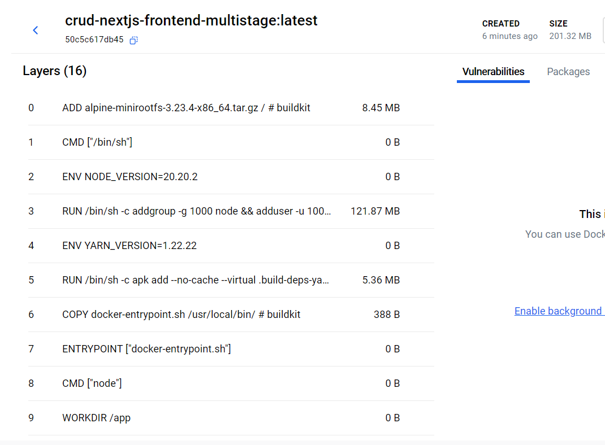

# CRUD-nextjs-frontend

A Next.js frontend for a simple Items CRUD app, backed by the
`CRUD-parse-server-backend` Parse Server API. The main purpose of the project is just to carry out some devops related activities like writing .dockerignore, dockerfile and docker-compose contents in order to build and push the created image to an online image repository.

- `/login` and `/register` — authenticate against Parse `_User`.
- `/` — single page listing your items, with inline create, edit, complete-toggle
  and delete. Requires login (each user only sees their own items, enforced by
  the backend via ACLs).

## Setup (without Docker)

```bash
npm install
cp .env.example .env.local
# edit .env.local so NEXT_PUBLIC_PARSE_SERVER_URL points at your running backend
npm run dev
```

Open [http://localhost:3000](http://localhost:3000).

## Environment variables

See `.env.example`. These must match the `APP_ID` / `SERVER_URL` configured
on the backend.

## Notes

- No `Dockerfile`, `docker-compose.yml`, or `.dockerignore` are included here
  on purpose — write those yourself as part of the DevOps exercise.

## .dockerignore

Excluded the .gitignore, .next and folders together with the .env files which end with .local

## Dockerfile

The docker file on this branch is a multistaged docker file which optimizes the image size.

It is divided into 2 stages: builder and runner. This reduces the size of the image as only the files created in the last stage will be found in the image, all the files in the other stages before will be discarded. Also, the nextconfig output property is set to "standalone" to make nextjs to install just the dependencies which are needed, create a server.js file which will be used to run the project, and also keep the source code as well.

1. FROM node:20-alpine AS builder ---start of the builder stage

2. WORKDIR /app --- sets the working directory to /app

3. COPY package\*.json ./ --- copies the package.json and package-lock.json files from the home directory to the image

4. RUN npm install -- install project depenencies

5. COPY . . --- copies all files from the home dir to the image

6. RUN npm run build --- builds project

7. FROM node:20-alpine AS runner --- starts the runner stage. When the docker file is done running, all the dependencies and files found in the builder stage will be discarded, hence a smaller image size at the end.

8. WORKDIR /app --- sets the work directory

9. ENV NODE_ENV=production --- sets the environment variables

10. COPY --from=builder /app/public ./public --- copies the public file from the builder stage since the standalone which was set doesn't copy the public folder

11. COPY --from=builder /app/.next/standalone ./ --- copies the contents of the standalone directory and places in the working directory. The standalone dir contents will be now used as the contents of the project

12. COPY --from=builder /app/.next/static ./.next/static --- copies the static css and js files responsible for the designs seen on the application. So at this stage, the public, .next/static and the content of the standalone directory will be in the working directory of the image

13. EXPOSE 3000 --- exposes the port 3000

14. CMD ["node", "server.js"] --- runs the server.js file which was gotten from the standalone directory

Here is an image showing the size of the image with the current dockerfile which was 201.32MB


