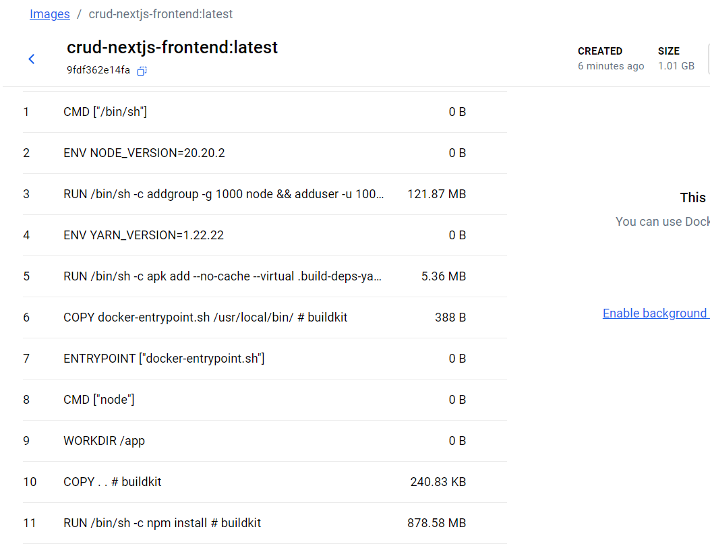

# CRUD-nextjs-frontend

A Next.js frontend for a simple Items CRUD app, backed by the
`CRUD-parse-server-backend` Parse Server API. The main purpose of the project is just to carry out some devops related activities like writing .dockerignore, dockerfile and docker-compose contents in order to build and push the created image to an online image repository.

- `/login` and `/register` — authenticate against Parse `_User`.
- `/` — single page listing your items, with inline create, edit, complete-toggle
  and delete. Requires login (each user only sees their own items, enforced by
  the backend via ACLs).

## Setup (without Docker)

```bash
npm install
cp .env.example .env.local
# edit .env.local so NEXT_PUBLIC_PARSE_SERVER_URL points at your running backend
npm run dev
```

Open [http://localhost:3000](http://localhost:3000).

## Environment variables

See `.env.example`. These must match the `APP_ID` / `SERVER_URL` configured
on the backend.

## Notes

- No `Dockerfile`, `docker-compose.yml`, or `.dockerignore` are included here
  on purpose — write those yourself as part of the DevOps exercise.

## .dockerignore

Excluded the .gitignore, .next and folders together with the .env files which end with .local

## Dockerfile

The docker file in on this branch is just the minimum dockerfile which doesn't consider optimizing the image.

It does the following

- FROM node:20-alpine

Starts the stage from the alpine image

- WORKDIR /app

Sets the working directory to /app

- COPY . .

Copies the whole project to the current working directory. All project files will be present in this layer of the image hence making its size a bit larger

- RUN npm install

Installs project dependencies.The main culprit responsible for the image bieng very large together withe the copy line. It bundles all the node_modules and project dependencies in one layer without removing cache

- EXPOSE 3000

Exposes the port 3000

- CMD ["npm", "run", "dev"]

Defines the command that will run on startup of the application.

Here is an image showing the size of the image with the current dockerfile which was 1.01GB


